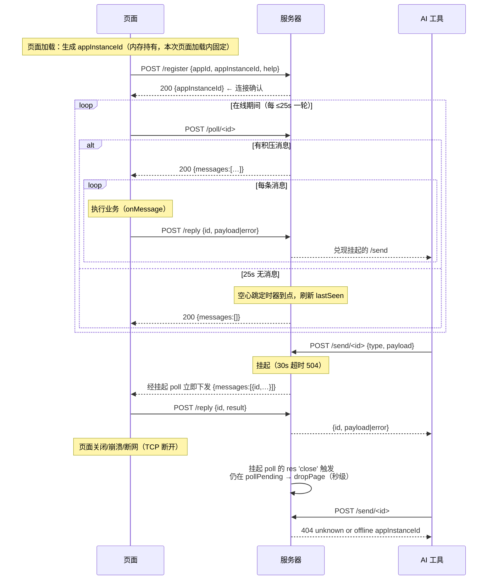

# 浏览器桥连接机制（Bridge Connection Lifecycle）

> 说明 `/bridge` 长轮询桥的完整连接生命周期：身份模型、上线、在线维持（25s 心跳）、
> 指令收发（poll/reply/send）、下线判定（close 秒级判死 + 60s 惰性兜底）。
> 实现位置：服务器 `src/bridge.js`；页面客户端 `public/bridge-client.js`（通用版）或
> 自研客户端（如 u32-earth 的 `ui/bridge.ts`，协议相同）。
>
> 日期：2026-11-15

## 1. 三角色与总架构

```
      页面（浏览器）                        服务器 (:19527)                     AI 工具
  ┌────────────────────┐          ┌──────────────────────────┐
  │ POST /register     │ ──①──▶   │ 名册 pages               │
  │ POST /poll/<id>    │ ──②──▶   │ 挂起 pollPending         │（无消息时挂起，
  │     （挂起等待）    │ ◀──挂起── │ 25s 空心跳定时器          │  有消息立即兑现）
  │ POST /reply        │ ──⑤──▶   │ 兑现挂起的 /send          │
  └────────────────────┘          └──────────────────────────┘
                                  ◀─ GET  /bridge/api/apps ─────── ③ AI 查哪些 App 在线
                                  ◀─ GET  /bridge/api/pages ────── ④ AI 查实例列表拿 id
                                  ◀─ POST /bridge/api/send/<id> ── ⑥ AI 发指令同步等回包
```

服务器只做透明转发与连接管理，不解释业务语义；全部状态在内存（`pages` / `pollPending` /
`outbox` / `sendPending` 四个 Map），服务器重启即清空。

## 2. 身份模型

| 标识 | 粒度 | 谁生成 | 生命周期 |
|---|---|---|---|
| `appId` | 一种 App 一个 | 页面侧定（代码常量） | 与 App 代码同生命周期 |
| `appInstanceId` | 一个页面实例一个 | **页面侧生成、必传** | **单次页面加载内固定**：加载页面时生成（UUID，内存持有、不持久化），断线重连沿用同一 id；刷新=新页面=新实例，多开标签页各自独立 id |
| 消息 `id` | 一条指令一个 | 服务器生成（`crypto.randomUUID()`） | 指令与回包的配对凭证 |

**设计要点（重要）**：`appInstanceId` 由页面生成，服务器 register 时**必填**，缺失/非法直接
400，服务器**不代生成**。原因：若服务器每次发新 id，页面断线重连/刷新后旧 id 会在名册中残留
（惰性判死窗口内），AI 可能拿到幽灵实例。页面固定 id + 服务器同 id upsert（清旧状态再登记）
语义配合，重连永远是同一个实例，不产生残留。

## 3. 上线：register

```
页面 → POST /bridge/api/register  { appId, appInstanceId, help, url?, title? }
      ← 200 { ok: true, appInstanceId }   （同 id 重复注册按 upsert 覆盖旧状态）
```

- **register 是立即返回的**——页面的"已连接"确认就来自这次响应（如 u32-earth 收到
  `appInstanceId` 后置 status=connected，工具栏按钮变绿）。
- `help` 是必传的协议自述：AI 经 `GET /bridge/api/apps` 读 help 即学会该 App 的指令用法。
- 校验：Host 白名单（防 DNS rebinding）+ 写接口 Origin 校验复用全局安全机制。

## 4. 在线维持：长轮询 + 25s 空心跳

页面 register 成功后进入死循环：`await fetch(/poll/<id>)` → 处理 → （有消息则 reply）→ 再发下一个 poll。

服务器 poll 处理顺序：

1. 名册查无此 id 或已判死 → 404；
2. 同 id 重复 poll（页面重复开循环）→ 先兑现/销毁旧挂起，防堆积；
3. outbox 有积压消息 → **立即返回**（一次可带多条）；
4. 无消息 → **挂起**：`pollPending` 记下 `{ res, timer }`，25s 定时器到点回 `{ messages: [] }`。

**25s 空心跳的双重作用（不可省略）**：

| 作用 | 机理 |
|---|---|
| 证明活着 | 每次心跳兑现/挂起都刷新 `lastSeen`，供 60s 惰性判死用；若 poll 无限挂起，lastSeen 永不更新，处理完指令的间隙会被 `checkAlive` 误杀活页面 |
| 维持链路 | 连接上持续有数据往返，本机防火墙/代理等中间环节不会掐"闲置"连接；也保证 `close` 事件只可能是真死亡，不会误伤 |

页面收到空数组后立即重发 poll，如此每 25s 一次一来回，形成稳定心跳节拍。

**页面侧如何感知连接状态**（三个时机各司其职）：

| 时机 | 页面感知方式 |
|---|---|
| 连接确认 | register 的立即 200 响应 |
| 持续在线 | poll 的周期性返回（消息或空心跳），每 ≤25s 一次 |
| 中途断开（服务器死/网络断） | 挂起中的 `fetch` 立即 reject（浏览器感知 TCP 断开），页面走错误处理/自动重连 |

## 5. 指令收发：send → poll 兑现 → reply

一次指令 = 3 个独立 HTTP 事务（下发与回包是两条独立请求，不是消息发两次）：

```
① AI    → POST /bridge/api/send/<appInstanceId> { type, payload, timeoutMs? }
          服务器挂起（sendPending，默认 30s 到点 504）
② 服务器 → 通过页面挂起的 poll 立即下发 { messages: [{ id, type, payload }] }
          （poll 无挂起则消息入 outbox 等下一个 poll；504 超时后消息出队，页面不会收到过期指令）
③ 页面  → 执行业务，POST /bridge/api/reply { id, payload | error }（每条指令一次 reply，按 id 幂等）
④ 服务器 → 兑现挂起的 /send，把 payload/error 原样回给 AI
⑤ 页面  → 回到循环开头发下一个 poll
```

页面正在处理上一条指令、还没发下一个 poll 时又来新指令 → 消息在 outbox 积压，等下一个
poll 一次带下去（`/pages` 的 `pendingMessages` 字段即积压数）。

**语义限制**：消息至多送达一次——poll 响应交付后消息即出队，页面收到后崩溃则消息丢失
（AI 靠 504 感知，自行重试）；不做超时重入队（避免重复执行风险）。

## 6. 下线判定：close 秒级判死 + 60s 惰性兜底

页面死亡（关闭标签页 / 崩溃 / 进程被杀 / 断网）的感知分两层：

### 6.1 秒级：挂起 poll 的 `close` 监听

挂起 poll 时给该 `res` 注册 `close` 事件。TCP 断开（对端关闭/崩溃/断网）→ Node 触发
`res` 的 `close` → **仅当这条 poll 仍在 `pollPending` 挂起名单中**才判死并 `dropPage`：

- 出名册（`pages.delete`）、清积压（`outbox.delete`）、清挂起并 `clearTimeout`；
- 守卫条件排除正常路径：来消息兑现、25s 到点、重复 poll 三条路径都**先
  `pollPending.delete` 再返回**，其 close 事后触发时已不在名单中，自然豁免；
- 判死同时 `clearTimeout`，25s 定时器不再触发，不会给死人刷新 `lastSeen`。

效果：页面关闭后**秒级**出名册，`/pages`、`/apps` 立即不再列出；此间 `/send` 直接 404。

### 6.2 兜底：60s 惰性判死

`checkAlive`：`无挂起 poll && now - lastSeen > 60s` → 判死移出。兜底覆盖 close 事件
未触发的极端场景（如 TCP 半开连接、内核级异常）。该判定是惰性的——在 `/pages`、
`/apps`、poll 到达时顺带执行，无后台定时扫描。

### 6.3 反方向感知（页面 → 服务器死了）

poll 挂起中途服务器死亡/重启：浏览器立即发现 TCP 断开，`fetch` reject → 页面走重连逻辑
（自研客户端按 autoReconnect 3s 重试；通用 bridge-client 指数退避 100ms→5s）。服务器重启
名册为空，页面用**同一个 appInstanceId** 重注册，upsert 无缝续接。

## 7. 故障模式一览

| 故障场景 | 行为 | 结局 |
|---|---|---|
| 页面关闭标签页 | 挂起 poll `close` 触发 → dropPage | 秒级出名册，/pages 不再列出，/send 404 |
| 页面崩溃/断网 | 同上 | 同上 |
| 页面收到指令后 JS 异常不回包 | /send 挂起到 30s | AI 收 504 |
| 服务器中途死亡/重启 | 页面 fetch reject | 页面自动重连，同 id upsert 续接 |
| AI 侧先行放弃（客户端超时） | sendPending 到期丢弃 | 无泄漏 |
| 长时间无指令 | 25s 空心跳节拍 | 页面在线维持，lastSeen 新鲜，不误杀 |
| 中间设备掐连接 | close 触发 | 视为页面死亡处理（心跳保证正常情况下不发生） |

## 8. 时序图（完整生命周期）


